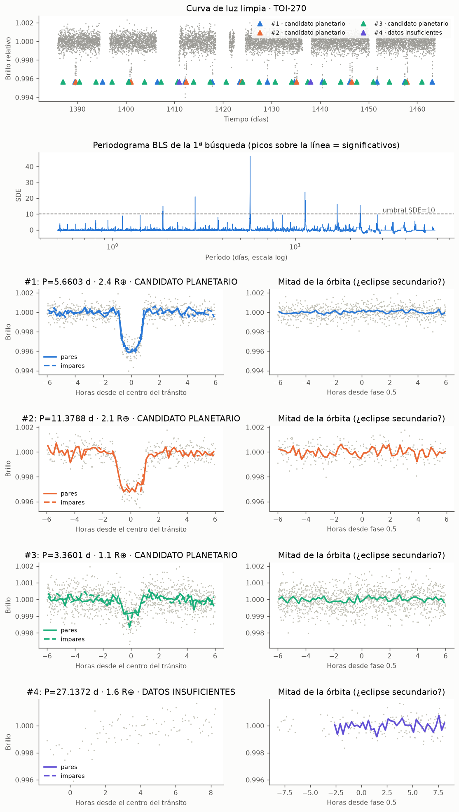
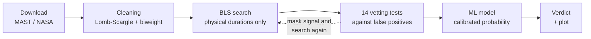
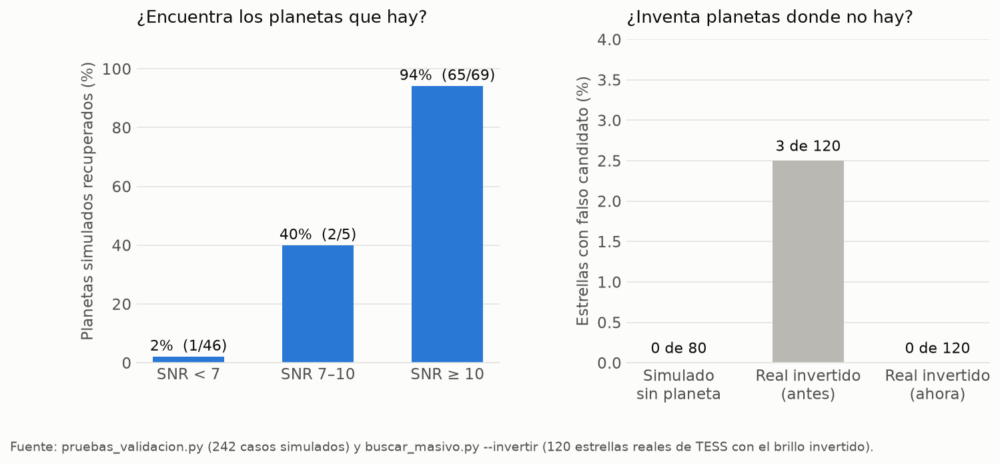

# Exoplanet finder for TESS data

**Searches for planets outside the Solar System in real data from NASA's TESS satellite, rejects false signals with physical tests, and ranks candidates with a machine learning model.**

🇪🇸 [Versión en español](README.md) · 📘 [Full technical documentation (Spanish)](docs/DOCUMENTACION.md)



*TOI-270, a star with three confirmed planets. The finder recovers all three without being told they exist, with the right periods and sizes close to the published ones. Plot labels are in Spanish.*

---

## The problem

When a planet crosses in front of its star, the light dips slightly (usually under 1 %), always with the same rhythm. TESS records the brightness of hundreds of thousands of stars, so finding those dips sounds easy.

It isn't. Most dips **are not planets**: eclipsing binary stars, starspots, asteroids crossing the camera, jumps when the spacecraft re-points. A finder that reports everything that dips is useless.

So most of the work in this project went into **rejecting what is false** and **measuring how often it is wrong**.

## How it works



1. **Downloads** light curves (SPOC, TESS-SPOC or QLP) and stellar parameters from the TIC catalog.
2. **Removes** the star's own variability without erasing transits (Lomb-Scargle prewhitening plus a robust biweight filter).
3. **Searches** for periodic signals with Box Least Squares, trying only durations allowed by Kepler's third law.
4. **Vets** each signal: odd vs even depths, secondary eclipse, V shape, maximum size, impossible duration, data-gap edges and more. Then it masks the signal and searches again (multi-planet systems).
5. **Scores** it with a model trained on 2,831 candidates already resolved by NASA.
6. **Returns a verdict with reasons**: planet candidate, likely false positive, insufficient data, or no detection.

A **batch mode** analyzes hundreds of stars unattended, saves progress after each one (it survives power cuts and reboots) and cross-matches results against catalogs of known planets.

## Results



| Test | Result |
|---|---|
| Simulated planets with clear signal (SNR ≥ 10) | **94 %** recovered (65 of 69) |
| Simulated stars with no planet | **0** false alarms in 80 |
| Real stars with inverted flux (where transits cannot exist) | **0** false alarms in 120 (3 before the fixes) |
| Measured vs true depth | −2.6 % bias |
| Simulated eclipsing binaries | 30 of 40 rejected; 8 of the other 10 flagged |
| ML model (cross-validation grouped by star) | AUC **0.90**; 0.85 on a temporal split |

**Known real stars:**

| Star | What it is | Finder result |
|---|---|---|
| Pi Mensae | 1 planet, P = 6.268 d | ✅ candidate, P = 6.2676 d, radius 1.98 R⊕ (published 2.04) |
| TOI-270 | 3 planets | ✅ all three, exact periods |
| WASP-18 | hot Jupiter that glows | ✅ candidate; identifies its "secondary eclipse" as the planet's own light |
| CM Draconis | eclipsing binary | ✅ rejected: "would cover 59 % of the star" |

**Real search:** 300 stars from sector 20 with no known objects, run overnight with 4 parallel processes: 0 candidates. That is the expected outcome, and it shows the finder does not invent planets in real data.

## Technical decisions that mattered

The most valuable part was not writing the detector but finding where it fooled itself:

- **Underestimated measurement error.** TESS noise is not purely random. Instead of assuming a formula, the program measures the same "dip" at ~150 random empty times and uses that spread as the real error.
- **Null test on real data.** Simulations gave 0 false alarms, but inverting the flux of real stars produced 3 "planets" in 120 stars. Three rules were added (minimum 3 transits, data-edge test, minimum duration) and it dropped to 0, at the cost of 6 % sensitivity.
- **Data leakage in the model.** Among candidates with missing stellar data only 7 % were planets, versus 55 % for the rest. A single model learned "missing value = false positive". The fix was two separate models, with and without stellar data.
- **Selection bias.** NASA resolves 63 % of bright candidates but only 20 % of faint ones. Corrected with inverse-probability weights.
- **Corrupted data.** Some QLP sectors contain points with near-zero flux that looked like 80-99 % transits. Physically impossible points are now removed and reported.

18 documented fixes are listed in the [technical documentation](docs/DOCUMENTACION.md#errores-corregidos-durante-el-desarrollo).

## Example: how a signal gets rejected

TIC 235718636 produced a huge signal: SNR 220, 580 dips across 15 sectors. It looked perfect, and the finder rejected it anyway, for three reasons:

- Odd and even dips had different depths, a **54σ** difference. A planet always blocks the same amount; two stars of different size do not.
- Each dip lasted **2.25 h**, while a planet on that orbit cannot take longer than **1.53 h**.
- Halfway through the orbit the light **rose**, typical of stars distorted by a close companion.

It was a binary star with a true period of ~1.19 days, not a planet.

## Limitations

- Only planets whose orbit crosses exactly in front of the star are visible.
- Favors large, short-period planets. With one sector (~27 days) it confirms periods up to ~9-13 days.
- A **background** eclipsing binary in the same pixel can mimic a perfect planet. The light curve alone cannot rule that out.
- The ML model "punishes the unusual": planets in sparsely populated regions get low probabilities even if real.
- **A candidate is not a planet.** Confirmation needs other observations (radial velocity, high-resolution imaging).

## Quick start

```bash
python -m venv venv
venv\Scripts\activate              # Linux/Mac: source venv/bin/activate
pip install -r requirements.txt

# A simulated star (no internet needed)
python buscador_transitos.py --demo multi

# A real star, with the ML model
python buscador_transitos.py --estrella "Pi Mensae" --clasificador ml/clasificador_toi.joblib

# 100 stars from sector 20 with no known objects
python buscar_masivo.py --sector 20 --max 100 --tmag 9 12 --sin-conocidos --salida busqueda_s20
```

Requires Python 3.11+ and internet access to download NASA data. Code, output and plots are in Spanish.

## Tech stack

Python · NumPy · SciPy · Astropy (BLS, Lomb-Scargle) · Lightkurve · scikit-learn (HistGradientBoosting, isotonic regression) · pandas · Matplotlib · multiprocessing

Data: [TESS / MAST](https://archive.stsci.edu/missions-and-data/tess), [ExoFOP-TESS](https://exofop.ipac.caltech.edu/tess/), [NASA Exoplanet Archive](https://exoplanetarchive.ipac.caltech.edu/).

## Author

**Carlos Silva** ([@cutoxx](https://github.com/cutoxx)) · Computer Engineering, INACAP Osorno, Chile.

MIT License.
