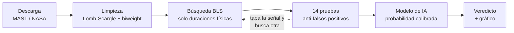

# Buscador de exoplanetas en datos de TESS

**Busca planetas fuera del Sistema Solar en datos reales del satélite TESS de la NASA, descarta las señales falsas con pruebas físicas y ordena los candidatos con un modelo de machine learning.**

🇬🇧 [English version](README.en.md) · 📘 [Documentación técnica completa](docs/DOCUMENTACION.md)


*TOI-270, una estrella con tres planetas confirmados. El buscador los encuentra sin saber que existen, con el período correcto y tamaños parecidos a los publicados.*

---

## El problema

Cuando un planeta pasa frente a su estrella, la luz baja un poco (menos del 1 %), siempre con el mismo ritmo. TESS mide la luz de cientos de miles de estrellas, así que encontrar esas caídas parece fácil.

No lo es. La gran mayoría de las caídas **no son planetas**: estrellas dobles que se eclipsan entre sí, manchas solares, asteroides que cruzan la cámara, saltos del satélite al reorientarse. Un buscador que reporta todo lo que baja no sirve para nada.

Por eso el trabajo de este proyecto está, sobre todo, en **descartar lo falso** y en **medir cuánto se equivoca**.

## Cómo funciona



1. **Descarga** las curvas de luz (SPOC, TESS-SPOC o QLP) y los datos de la estrella del catálogo TIC.
2. **Limpia** la variabilidad propia de la estrella sin borrar los tránsitos (pre-blanqueo con Lomb-Scargle y filtro robusto *biweight*).
3. **Busca** señales periódicas con *Box Least Squares*, probando solo duraciones que la 3ª ley de Kepler permite.
4. **Pone a prueba** cada señal: pares vs impares, eclipse secundario, forma en V, tamaño máximo, duración imposible, bordes de datos y más. Si encuentra una, la tapa y busca la siguiente (sistemas con varios planetas).
5. **Calcula una probabilidad** con un modelo entrenado en 2.831 candidatos que la NASA ya resolvió.
6. **Entrega un veredicto** que explica el porqué: `CANDIDATO PLANETARIO`, `PROBABLE FALSO POSITIVO`, `DATOS INSUFICIENTES` o `SIN DETECCIÓN`.

Además trae un **modo masivo** que analiza cientos de estrellas solo, guarda el avance después de cada una (sobrevive a cortes de luz y reinicios) y cruza los resultados con los catálogos de planetas conocidos.

## Resultados


| Prueba | Resultado |
|---|---|
| Planetas simulados con señal clara (SNR ≥ 10) | **94 %** recuperados (65 de 69) |
| Estrellas simuladas sin planeta | **0** falsas alarmas en 80 |
| Estrellas reales con el brillo invertido (donde no puede haber tránsitos) | **0** falsas alarmas en 120 (antes de las correcciones: 3) |
| Profundidad medida vs real | sesgo de −2,6 % |
| Binarias eclipsantes simuladas | 30 de 40 descartadas; 8 de las 10 restantes con advertencia |
| Modelo de IA (validación agrupada por estrella) | AUC **0,90**; 0,85 con validación temporal |

**Con estrellas reales conocidas:**

| Estrella | Qué es | Resultado del buscador |
|---|---|---|
| Pi Mensae | 1 planeta, P = 6,268 d | ✅ candidato, P = 6,2676 d, radio 1,98 R⊕ (publicado 2,04) |
| TOI-270 | 3 planetas | ✅ los tres, con período exacto |
| WASP-18 | Júpiter caliente que brilla | ✅ candidato; reconoce que su "eclipse secundario" es luz del planeta |
| CM Draconis | estrella doble | ✅ descartada: "taparía el 59 % de la estrella" |

**Búsqueda real:** 300 estrellas del sector 20 sin objetos conocidos, en una noche con 4 procesos en paralelo. Resultado: 0 candidatos. Es lo esperable, y prueba que el buscador no inventa planetas en datos reales.

## Decisiones técnicas que importan

Lo más útil de este proyecto no fue escribir el detector, sino encontrar dónde se engañaba solo:

- **Error de medición subestimado.** El ruido real de TESS no es aleatorio puro. En vez de suponer una fórmula, el programa mide la misma "caída" en ~150 momentos al azar donde no hay nada y usa esa dispersión como error real.
- **Prueba nula con datos reales.** Las simulaciones daban 0 falsas alarmas, pero al invertir el brillo de estrellas reales aparecieron 3 "planetas" en 120 estrellas. Se agregaron tres reglas (mínimo 3 tránsitos, bordes de datos, duración mínima) y bajó a 0, a cambio de perder un 6 % de sensibilidad.
- **Fuga de datos en el modelo.** Entre los candidatos sin datos de la estrella solo el 7 % eran planetas, contra el 55 % del resto. Un modelo único aprendía "falta un dato = falso positivo". La solución fue entrenar dos modelos: uno con datos estelares y otro sin ellos.
- **Sesgo de selección.** La NASA resuelve el 63 % de los candidatos brillantes y solo el 20 % de los débiles. Se corrigió con pesos por probabilidad inversa.
- **Datos dañados.** Algunos sectores de QLP traen puntos con luz casi en cero que el buscador tomaba como tránsitos del 80-99 %. Ahora se descartan los puntos físicamente imposibles y se avisa cuántos.

Hay 18 errores corregidos documentados en la [documentación técnica](docs/DOCUMENTACION.md#errores-corregidos-durante-el-desarrollo).

## Ejemplo: cómo se descarta una señal

TIC 235718636 dio una señal enorme: SNR 220 y 580 caídas en 15 sectores. Parecía perfecta, y el buscador la descartó igual, por tres motivos:

- Las caídas pares e impares tenían profundidades distintas, con una diferencia de **54σ**. Un planeta tapa siempre lo mismo; dos estrellas de distinto tamaño no.
- Cada caída duraba **2,25 h**, cuando un planeta con esa órbita no puede tardar más de **1,53 h**.
- A mitad de órbita la luz **subía**, algo típico de estrellas deformadas por su compañera.

Era una estrella doble con período real de ~1,19 días, no un planeta.

## Limitaciones

- Solo ve planetas cuya órbita pasa justo frente a la estrella.
- Favorece planetas grandes y de período corto. Con un sector (~27 días) confirma períodos de hasta ~9-13 días.
- Una estrella doble **de fondo** dentro del mismo píxel puede imitar un planeta perfecto. Eso no se descarta con la curva de luz sola.
- El modelo de IA "castiga lo raro": planetas en zonas poco pobladas reciben probabilidades bajas aunque sean reales.
- **Candidato no es planeta.** Confirmarlo requiere otras observaciones (velocidad radial, imágenes de alta resolución).

## Uso rápido

```bash
python -m venv venv
venv\Scripts\activate              # Linux/Mac: source venv/bin/activate
pip install -r requirements.txt

# Una estrella simulada (no necesita internet)
python buscador_transitos.py --demo multi

# Una estrella real, con el modelo de IA
python buscador_transitos.py --estrella "Pi Mensae" --clasificador ml/clasificador_toi.joblib

# 100 estrellas del sector 20 sin objetos conocidos
python buscar_masivo.py --sector 20 --max 100 --tmag 9 12 --sin-conocidos --salida busqueda_s20
```

Requiere Python 3.11 o superior e internet para descargar los datos de la NASA.

## Estructura

```
├── buscador_transitos.py    # detector, pruebas y gráficos
├── buscar_masivo.py         # búsqueda masiva con avance guardado
├── pruebas_validacion.py    # 242 casos simulados
├── validar_reales.py        # validación con estrellas reales
├── ml/
│   ├── caracteristicas.py         # variables del modelo
│   ├── entrenar_clasificador.py   # entrenamiento y métricas
│   ├── clasificador_toi.joblib    # modelos entrenados
│   └── datos/                     # catálogos TOI, CTOI y planetas confirmados
└── docs/
    ├── DOCUMENTACION.md     # todas las pruebas, tablas y opciones
    └── img/
```

## Tecnologías

Python · NumPy · SciPy · Astropy (BLS, Lomb-Scargle) · Lightkurve · scikit-learn (HistGradientBoosting, regresión isotónica) · pandas · Matplotlib · multiprocessing

Datos: [TESS / MAST](https://archive.stsci.edu/missions-and-data/tess), [ExoFOP-TESS](https://exofop.ipac.caltech.edu/tess/), [NASA Exoplanet Archive](https://exoplanetarchive.ipac.caltech.edu/).

## Autor

**Carlos Silva** ([@cutoxx](https://github.com/cutoxx)) · Ingeniería en Informática, INACAP Osorno, Chile.

Licencia MIT.
